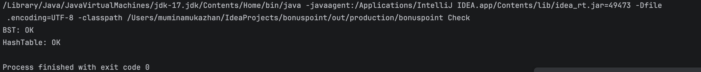
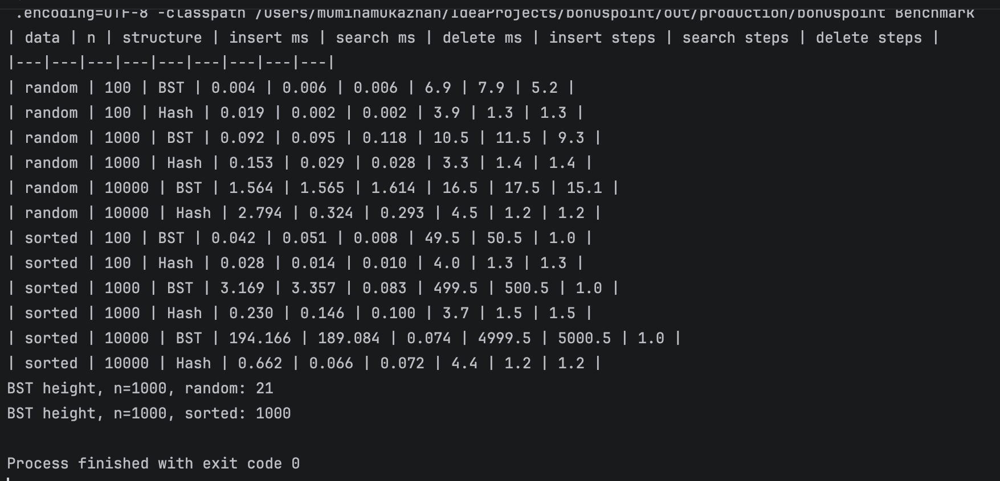

# BST vs Hash Table: Performance Comparison

**Author:** Mukazhan Mumina
**Group:** SE-2530

Implementation and experimental comparison of a Binary Search Tree (BST) and a Hash Table in Java.

## 1. Project structure

```
src/
├── IntMap.java      common interface (insert, search, delete, size, steps)
├── BST.java         iterative binary search tree
├── HashTable.java   open addressing hash table
├── Benchmark.java   timing experiments
└── Check.java       correctness test against java.util.HashMap
screenshots/         console output screenshots
results.csv          raw results
results.md           results as a table
README.md            this report
```

**How to run:** open the project in IntelliJ IDEA (JDK 17) and run `Benchmark` (experiments, writes `results.csv` and `results.md`) or `Check` (correctness test).

## 2. Implementation

**BST**
- Fully iterative (no recursion), so it cannot cause `StackOverflowError` on a degenerate tree.
- Delete handles 0, 1 and 2 children; with two children the node is replaced by its in-order successor.
- Does not self-balance, so input order matters.

**Hash Table**
- Open addressing with linear probing.
- Fibonacci hashing: `(key * 0x9E3779B9) >>> (32 - bits)`.
- Deleted cells are marked with a tombstone, so probe chains are not broken.
- The table doubles when the load factor (including tombstones) exceeds 0.6.

Both structures count **steps** (visited nodes for BST, probes for the hash table). This explains the timing differences independently of machine noise.

## 3. Complexity analysis

| Operation | BST best | BST average | BST worst | Hash best | Hash average | Hash worst |
|---|---|---|---|---|---|---|
| Insert | O(1) | O(log n) | O(n) | O(1) | O(1) amortized | O(n) |
| Search | O(1) | O(log n) | O(n) | O(1) | O(1) | O(n) |
| Delete | O(1) | O(log n) | O(n) | O(1) | O(1) | O(n) |

**BST.** Every operation walks from the root down, so the cost is the tree height h.
- Best case: the key is at the root (or the tree is empty), O(1).
- Average case: random keys give a height of about log n.
- Worst case: sorted input makes the tree a linked list with h = n, so O(n).

**Hash Table.** The cost is the length of the probe sequence.
- Best case: the first probed cell is empty or holds the key, O(1).
- Average case: with load factor <= 0.6 probe sequences are short, O(1).
- Worst case: many keys collide into one cluster (bad hash function, high load), O(n).
- A single resize costs O(n), but doubling makes insertion O(1) amortized.

## 4. Experiments

**Setup:** sizes 100, 1,000 and 10,000; two datasets (random keys and sorted keys); 7 repetitions per measurement, median reported; JIT warm-up before measuring; fixed random seed (42). Each run inserts all keys, searches all keys, then deletes all keys. Time is the total for all n operations, in milliseconds. Steps are averages per operation.

| data | n | structure | insert ms | search ms | delete ms | insert steps | search steps | delete steps |
|---|---|---|---|---|---|---|---|---|
| random | 100 | BST | 0.004 | 0.006 | 0.006 | 6.9 | 7.9 | 5.2 |
| random | 100 | Hash | 0.019 | 0.002 | 0.002 | 3.9 | 1.3 | 1.3 |
| random | 1000 | BST | 0.092 | 0.095 | 0.118 | 10.5 | 11.5 | 9.3 |
| random | 1000 | Hash | 0.153 | 0.029 | 0.028 | 3.3 | 1.4 | 1.4 |
| random | 10000 | BST | 1.564 | 1.565 | 1.614 | 16.5 | 17.5 | 15.1 |
| random | 10000 | Hash | 2.794 | 0.324 | 0.293 | 4.5 | 1.2 | 1.2 |
| sorted | 100 | BST | 0.042 | 0.051 | 0.008 | 49.5 | 50.5 | 1.0 |
| sorted | 100 | Hash | 0.028 | 0.014 | 0.010 | 4.0 | 1.3 | 1.3 |
| sorted | 1000 | BST | 3.169 | 3.357 | 0.083 | 499.5 | 500.5 | 1.0 |
| sorted | 1000 | Hash | 0.230 | 0.146 | 0.100 | 3.7 | 1.5 | 1.5 |
| sorted | 10000 | BST | 194.166 | 189.084 | 0.074 | 4999.5 | 5000.5 | 1.0 |
| sorted | 10000 | Hash | 0.662 | 0.066 | 0.072 | 4.4 | 1.2 | 1.2 |

BST height for n = 1000: **21** (random keys), **1000** (sorted keys).

### Comparison

- **Random data.** The hash table is about 5 times faster for search and delete at n = 10,000 (search 0.32 ms vs 1.57 ms, delete 0.29 ms vs 1.61 ms). It needs about 1.2 probes per operation versus about 17 node visits in the BST (close to log2(10,000) = 13.3). Insertion into the hash table is slower (2.79 ms vs 1.56 ms), probably because of periodic resizing and rehashing (rehashing steps are also counted).
- **Sorted data.** The BST degenerates into a list: height 1000 for n = 1000, and the number of steps is about n/2, which confirms O(n). Inserting 10,000 sorted keys takes 194.2 ms versus 0.66 ms for the hash table (about 290 times slower). The hash table is almost unaffected by input order.
- **Delete in sorted BST (1 step).** Keys are deleted in ascending order, so each deleted node is the root without a left child and is replaced by its right child immediately. This is a property of the deletion order, not of the BST in general.
- **Noise.** The benchmark was run three times. Step counts and tree heights were identical in every run, while absolute times on random data varied by 50-100% (system load, JIT). The ratios stayed stable: on sorted data at n = 10,000 the BST was roughly 260-295 times slower for insertion in all runs. Times for n = 100 are close to measurement noise, so conclusions rely on n = 1,000 and 10,000 and on the step counts.

### Correctness

`Check.java` runs 200,000 random insert/search/delete operations on each structure and compares every result and the size with `java.util.HashMap`.

### Screenshots

Correctness check:



Benchmark output:



## 5. Why performance differs in practice

- **Number of memory accesses.** The hash table computes an index and checks a few cells; the BST follows up to h pointers.
- **Cache locality.** BST nodes are separate objects scattered in the heap, so each step may be a cache miss. The hash table stores data in contiguous `int[]` arrays, and linear probing reads neighbouring cells.
- **Balance.** The plain BST has no balancing; its speed depends on input order. The hash table's speed depends on the hash function and load factor, not on key order.
- **Resizing.** Rehashing makes some insertions expensive, although the amortized cost stays O(1).
- **Clustering.** Linear probing is cache friendly but suffers from clustering at high load, which is why the load factor is kept at or below 0.6.
- **Functionality.** The BST keeps keys ordered (range queries, min/max, sorted traversal); the hash table does not. Balanced trees (AVL, Red-Black) guarantee O(log n).

## 6. Conclusions

For exact-key lookup, insertion and deletion the hash table is faster and more predictable. The plain BST is competitive only on random data and becomes very slow on sorted data (O(n)). A BST is the better choice when ordered operations are needed, preferably in a self-balancing form such as AVL or Red-Black tree.

## 7. Limitations

- Keys and values are `int`; `search` returns `Integer`, so boxing slightly inflates absolute times for both structures.
- Absolute times depend on the machine and JVM (Java 17, MacBook Air); only the ratios and step counts should be compared.
- Only two key distributions were tested (random and sorted).
